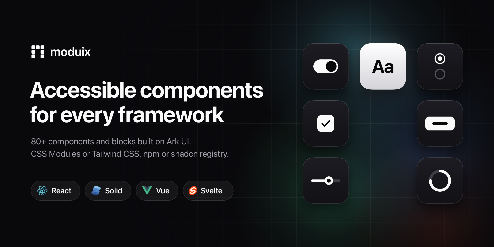

[](https://www.npmjs.com/package/@moduix/svelte)
[](./LICENSE.md)
[](https://www.typescriptlang.org/)

# @moduix/svelte

Svelte 5 components built on [Ark UI](https://ark-ui.com/), styled with CSS Modules.
Compose components from flat named parts using runes, snippets, and native Svelte bindings.

[Quick start](https://moduix.dev/docs/quick-start) ·
[Components](https://moduix.dev/docs/components) ·
[Styling](https://moduix.dev/docs/styling)

## Install

Start from an existing application using Svelte 5.29 or later in the 5.x line, such as a SvelteKit
or Vite app.

Install moduix and its matching Ark UI peer dependency:

```bash
pnpm add @moduix/svelte @ark-ui/svelte
```

Import components from subpaths such as `@moduix/svelte/accordion`; there is no package-root
export. Only the optional Chart integration requires an additional peer: `pnpm add @tanstack/charts`.

## Add styles

Import the reset and foundation once, for example in `src/routes/+layout.svelte` for SvelteKit or
`src/main.ts` for Vite:

```ts
import '@moduix/svelte/reset.css';
import '@moduix/svelte/style.css';
```

If your application already provides an equivalent reset, omit `reset.css`. The foundation supplies
shared tokens and base styles; component imports load their own CSS Modules.

## Use a component

```svelte
<script lang="ts">
  import {
    Accordion,
    AccordionItem,
    AccordionItemBody,
    AccordionItemContent,
    AccordionItemIndicator,
    AccordionItemTrigger,
  } from '@moduix/svelte/accordion';
</script>

<Accordion defaultValue={['first']}>
  <AccordionItem value="first">
    <AccordionItemTrigger>
      What is moduix?
      <AccordionItemIndicator />
    </AccordionItemTrigger>
    <AccordionItemContent>
      <AccordionItemBody
        >A component library built on accessible Ark UI primitives.</AccordionItemBody
      >
    </AccordionItemContent>
  </AccordionItem>
</Accordion>
```

The family name is the root component. Each additional part is a separate family-prefixed export.
The setup is working when the trigger is styled and the panel opens with keyboard and pointer input.

## Customize

Use `class` on the root or a named part, stable `data-slot` hooks, and Ark state attributes
for application styles. Override shared CSS tokens or component variables for more focused changes.

The optional presets are `dense`, `soft`, and `contrast`. See
[Themes](https://moduix.dev/docs/themes) for imports and activation, and
[Tokens](https://moduix.dev/docs/tokens) for available CSS properties.

## Own the source

Configure `components.json` and aliases with the
[registry setup](https://moduix.dev/docs/quick-start#install-with-the-shadcn-cli), then add a component:

```bash
pnpm dlx shadcn@latest add @moduix-svelte/accordion
```

The CLI copies native Svelte source, styles, and dependencies into your project. Follow Quick Start
to connect the generated foundation stylesheet. The same namespace also installs
[blocks](https://moduix.dev/blocks), for example `@moduix-svelte/login-simple`.

## Compatibility

Unlike the React, Solid, and Vue packages, this package ships `.svelte` source instead of compiled
JavaScript. Your Svelte compiler builds it together with the application, so the output always
matches your Svelte version, and SvelteKit renders it on the server without extra configuration.

The package is ESM-only and resolves through the `svelte` export condition. Use SvelteKit or Vite
with `@sveltejs/vite-plugin-svelte`. See the
[framework guides](https://moduix.dev/docs/installation/vite) for entry files,
aliases, and SSR integration.

## Links

- [Documentation](https://moduix.dev/)
- [npm package](https://www.npmjs.com/package/@moduix/svelte)
- [Source repository](https://github.com/Blinks44/moduix)
- [Issues](https://github.com/Blinks44/moduix/issues)

## License

[MIT](./LICENSE.md)